# HanLearn Sprint 8N – Pedagogical & Learning Experience Audit (Zero-to-HSK 1 Journey)

**Ngày kiểm toán:** 2026-11-17  
**Đối tượng người học mục tiêu:** Người Việt bắt đầu học tiếng Trung từ con số 0 (Zero-background Mandarin Learner).

---

## 1. Mô phỏng Hành trình Học tập từ Số 0 (Learner Journey Simulation)

```mermaid
flowchart LR
  M0["Module 0: Pinyin (21 Thanh mẫu, 36 Vận mẫu, 4 Thanh + Biến điệu)"] --> U1["Unit 1 (Bài 1-4): Chào hỏi, Tên, Gia đình, Ngày tháng"]
  U1 --> U2["Unit 2 (Bài 5-8): Nghề nghiệp, Giờ giấc, Mua sắm, Ăn uống"]
  U2 --> U3["Unit 3 (Bài 9-14): Vị trí, Đi lại, Thời tiết, Trường học"]
  U3 --> U4["Unit 4 (Bài 15-20): Nhà cửa, Sức khỏe, Trang phục, Ẩm thực, Sở thích"]
  U4 --> U5["Unit 5 (Bài 21-25): Lịch trình, Điện thoại, Giao thông, Khách sạn, Phương hướng"]
  U5 --> U6["Unit 6 (Bài 26-32): Số lớn, Xưng hô, Động tác, Trạng thái, Tổng ôn"]
  U6 --> EXAM["Đề thi thử HSK 1 (40 câu / 35 phút)"]
```

---

## 2. Đánh giá Module 0 Pinyin (`content/hsk_library/module0_pinyin.json`)

### 2.1. Trước khi kiểm toán (Các rào cản với người mới bắt đầu)
1. **Lỗi phát âm TTS nghiêm trọng (P0):** Khi người mới bấm vào nút `b`, `p`, `q`, `zh` hoặc `mǎ` trên trang `/pinyin`, ứng dụng truyền thẳng chữ cái Latinh vào Web Speech API giọng `zh-CN`. Kết quả là trình duyệt đọc thành tên chữ cái tiếng Anh (*"bee"*, *"pee"*, *"cue"*, *"zee-aitch"*), khiến người học từ số 0 bị nghe sai hoàn toàn âm tiếng Trung ngay từ buổi học đầu tiên!
2. **Thiếu 12 vận mẫu ghép:** Tiêu đề ghi "36 Vận mẫu" nhưng chỉ có 24 vận mẫu, thiếu toàn bộ 12 vận mẫu có giới âm `i-, u-, ü-` (`ia, iao, ian, iang, iong, ua, uo, uai, uan, uang, ueng, üan`).
3. **Diễn giải tương đương tiếng Việt dễ gây hiểu nhầm:** Ghi `q (si bật hơi)` khiến người học đọc `q` thành âm xát `s/x` thay vì âm tắc xát mặt lưỡi `chi bật hơi` (`[tɕʰ]`).
4. **Thiếu quy tắc chính tả `j, q, x, y + ü`:** Người mới học đến Bài 2 (`汉语 Hànyǔ`), Bài 9 (`去 qù`), Bài 10 (`学校 xuéxiào`) không hiểu tại sao viết là `u` nhưng lại đọc tròn môi như `ü`.

### 2.2. Sau khi khắc phục
- **Chuẩn hóa 100% âm hô độc (`呼读音` *hūdúyīn*):** Ánh xạ toàn bộ 21 thanh mẫu (`波, 坡, 摸, 佛...`), 36 vận mẫu (`啊, 喔, 鹅...`) và 5 mức thanh điệu (`妈, 麻, 马, 骂, 吗`) sang chữ Hán chuẩn trước khi phát âm qua `zh-CN` TTS.
- **Đầy đủ 36 vận mẫu** chia làm 5 nhóm trực quan.
- **Bổ sung quy tắc chính tả `j, q, x, y + ü`** và lưu ý rõ phiên âm tiếng Việt chỉ là gợi ý vị trí cấu âm.

---

## 3. Kiểm tra Thứ tự Sư phạm & Dependency Graph của 32 Bài học (Section 6 & 6.1)

### 3.1. Cấu trúc 10 chặng mỗi bài học (Micro-learning Scaffolding)
Mỗi bài trong 32 bài học đều tuân thủ tiến trình nhận thức chuẩn từ dễ đến khó (Scaffolding):
1. **Chặng 0 (`0_warmup`)**: Khởi động nhận diện 3–4 từ khóa cốt lõi.
2. **Chặng 1 (`1_vocab_core`)**: Học từ vựng trọng tâm (Chữ Hán, Pinyin, Nghĩa Việt, Audio).
3. **Chặng 2 (`2_vocab_practice`)**: Bài tập củng cố từ vựng ngay lập tức.
4. **Chặng 3 (`3_grammar_core`)**: Giải thích điểm ngữ pháp + công thức + ví dụ song ngữ.
5. **Chặng 4 (`4_grammar_practice`)**: Bài tập áp dụng cấu trúc ngữ pháp vừa học.
6. **Chặng 5 (`5_dialogue_interactive`)**: Hội thoại ngữ cảnh thực tế + câu hỏi hiểu hội thoại.
7. **Chặng 6 (`6_listening_speaking`)**: Luyện nghe hiểu & phản xạ nói.
8. **Chặng 7 (`7_reading_comprehension`)**: Đọc đoạn văn ngắn tổng hợp từ + ngữ pháp trong bài.
9. **Chặng 8 (`8_mini_quiz`)**: Bài kiểm tra ngắn 8 câu đánh giá mức độ nắm bài.
10. **Chặng 9 (`9_summary`)**: Tổng kết kiến thức & kết nối sang bài học tiếp theo.

### 3.2. Phát hiện & Khắc phục Lỗ hổng Dependency ở Unit 1
- **Phát hiện:** Trong Bài 1 (*Chào hỏi & Tự giới thiệu*) và Bài 4 (*Hôm nay thứ mấy?*), các đại từ và số đếm nền tảng nhất (`你, 我, 好, 很, 吗, 谢谢, 再见, 天, 一, 二, 三, 四, 五, 六, 七`) chỉ xuất hiện thoáng qua ở `warmup_words` hoặc trong hội thoại mà **không có mặt trong chặng 1 Từ vựng trọng tâm (`1_vocab_core`)**! Hệ quả là học viên vào Bài 4 phải ghép `星期一`..`星期六` và vào Bài 6 phải nói giờ `三点十分` mà chưa từng được học chính thức các thẻ từ `一` đến `七` trong `1_vocab_core`.
- **Khắc phục:** Đã bổ sung đầy đủ 7 từ gốc (`你, 我, 好, 很, 吗, 谢谢, 再见`) vào `1_vocab_core` của Bài 1 và 8 từ chỉ ngày/số đếm (`天, 一, 二, 三, 四, 五, 六, 七`) vào `1_vocab_core` của Bài 4. Nhờ đó, đồ thị phụ thuộc (Dependency Graph) của Unit 1 $\rightarrow$ Unit 2 hoàn toàn khép kín, không còn nhảy cóc kiến thức.

### 3.3. Phân tích Tải lượng Nhận thức (Cognitive Load) theo 6 Units
| Unit | Số bài | Số từ mục tiêu (HSK 2025) | Số điểm ngữ pháp | Đánh giá tải lượng & Tiến trình |
| :--- | :---: | :---: | :---: | :--- |
| **Unit 1** (Bài 1–4) | 4 | 53 từ | 12 | Hợp lý; gồm nhiều từ đơn cơ bản (đại từ `你, 我`, số `1–7`, thành viên gia đình). |
| **Unit 2** (Bài 5–8) | 4 | 21 từ mới (+ ôn lại Unit 1) | 8 | Nhẹ nhàng; giúp học viên củng cố kỹ năng ghép câu với thời gian, tiền tệ và gọi món. |
| **Unit 3** (Bài 9–14) | 6 | 56 từ | 10 | Cân đối (~9 từ mới/bài); mở rộng sang không gian (`在`), phương tiện (`坐`) và năng lực (`会`). |
| **Unit 4** (Bài 15–20) | 6 | 55 từ | 6 | Tập trung vào từ vựng chủ đề đời sống (trang phục, màu sắc, ăn uống, sở thích), giảm tải ngữ pháp mới. |
| **Unit 5** (Bài 21–25) | 5 | 55 từ | 5 | Rèn luyện giao tiếp tình huống (hẹn giờ, gọi điện, hỏi đường, khách sạn). |
| **Unit 6** (Bài 26–32) | 7 | 60 từ | 13 | Tổng hợp các cấu trúc hoàn thiện câu (`正在`, `了`, `不要/别`, `一点儿/有点儿`) chuẩn bị cho kỳ thi HSK 1. |

---

## 4. Đánh giá Cân bằng 6 Kỹ năng & Hệ thống Ôn tập SRS (Section 10.3 – 10.5)

1. **Sự cân bằng kỹ năng (Skill Balance):**
   - Hệ thống kết hợp chặt chẽ giữa học theo bài (32 bài × 10 chặng) và luyện tập chuyên sâu theo kỹ năng tại **Trung tâm Luyện tập (56 bộ / 381 câu)**:
     - **Từ vựng (12 bộ / 96 câu)** & **Ngữ pháp (10 bộ / 80 câu)**: Chiếm tỷ trọng lớn nhất để xây nền tảng ngôn ngữ vững chắc.
     - **Nghe hiểu (10 bộ / 60 câu)** & **Đọc hiểu (8 bộ / 48 câu)**: Bám sát 2 phần thi chính thức của đề thi HSK 1 (Nghe + Đọc).
     - **Luyện nói (8 bộ / 48 lượt)** & **Hội thoại phân vai (8 bộ / 49 lượt)**: Bổ sung kỹ năng sản sinh ngôn ngữ (Output), trình bày minh bạch là chế độ luyện phát âm và tự đối chiếu, không tuyên bố chấm điểm AI giả tạo.
2. **Chất lượng Phản hồi (Feedback Quality):**
   - 100% câu hỏi trong Lesson Exercises, Practice Bank, Curriculum Quizzes, Unit Tests và Mock Exam đều có giải thích tiếng Việt (`explanation_vi`) nêu rõ **vì sao đáp án đó đúng** (kèm nghĩa từ vựng hoặc công thức ngữ pháp).
3. **Tích hợp SRS Flashcard:**
   - Hệ thống hỗ trợ 3 chiều thẻ (`hanzi_to_vi`, `vi_to_hanzi`, `audio_to_hanzi`).
   - Bộ lọc `sanitizeCardPrompt()` đảm bảo mặt trước thẻ `vi_to_hanzi` chỉ hiển thị nghĩa tiếng Việt cốt lõi, giữ nguyên các ghi chú biến điệu và cách dùng để hiển thị đầy đủ ở mặt sau sau khi lật thẻ.
