# HanLearn Sprint 8O – Phase 1: Database & Grading Architecture Audit

**Ngày kiểm toán:** 2026-11-20  
**Môi trường đối chiếu:** Local Codebase + Local PostgreSQL 18 + Supabase Cloud Development (`hhgxrjqkuwdgurphopok` – `VERIFIED CLOUD READ ONLY`)

---

## 1. Bản đồ Quan hệ Thực tế (Entity & Data Flow Map)

```mermaid
flowchart TD
  subgraph Client["Browser Client (Next.js App Router)"]
    UI_MQ["Mini Quiz UI (/lessons/[id]/quiz)"]
    UI_UT["Unit Test UI (/exam/unit/[unitId])"]
    UI_ME["Mock Exam UI (/exam/hsk1)"]
    UI_VOC["Vocabulary UI (/vocabulary, /vocabulary/[id])"]
    UI_REV["SRS Review UI (/review)"]
  end

  subgraph Server["Next.js Server Actions & Server-Only Queries"]
    Q_ACT["src/features/quizzes/actions.ts & queries.ts"]
    UT_ACT["src/features/exam/unit-test-actions.ts"]
    ME_ACT["src/features/exam/actions.ts"]
    VOC_Q["src/features/vocabulary/queries.ts & hsk1-library-vocab.ts"]
    REV_Q["src/features/review/queries.ts & actions.ts"]
    REV_MAP["src/features/quizzes/quiz-revisions.ts (Server-Only)"]
  end

  subgraph DB_Public["PostgreSQL public Schema (RLS Enabled)"]
    T_CQA["public.curriculum_quiz_attempts"]
    T_QA["public.quiz_attempts & quiz_responses"]
    T_VOC["public.vocabulary (44 Pilot -> 301 synced)"]
    T_SV["public.syllabus_vocabulary (43 Pilot -> 300 synced)"]
    T_LV["public.lesson_vocabulary (66 Pilot links)"]
    T_RC["public.review_cards (FK -> public.vocabulary.id)"]
    T_RE["public.review_events (FK -> public.review_cards)"]
    V_VP["public.vocabulary_progress (View over review_cards)"]
  end

  subgraph DB_Private["PostgreSQL private Schema (Unexposed, Zero Client Grants)"]
    P_CQD["private.curriculum_quiz_definitions"]
    P_CQK["private.curriculum_quiz_keys (1,284 rows: v1 + v2)"]
    P_QAK["private.quiz_answer_keys (Pilot 24 questions)"]
    RPC_SUB["private.submit_curriculum_quiz_attempt(uuid, jsonb)"]
    RPC_SRS["private.submit_review(...)"]
    RPC_SYNC["private.sync_hsk1_canonical_vocabulary_catalog(uuid)"]
  end

  UI_MQ --> Q_ACT
  UI_UT --> UT_ACT
  UI_ME --> ME_ACT
  UI_VOC --> VOC_Q
  UI_REV --> REV_Q

  Q_ACT --> REV_MAP
  UT_ACT --> REV_MAP
  Q_ACT --> T_CQA
  Q_ACT --> RPC_SUB
  UT_ACT --> T_CQA
  UT_ACT --> RPC_SUB
  RPC_SUB --> P_CQD
  RPC_SUB --> P_CQK
  RPC_SUB --> T_CQA

  VOC_Q --> T_VOC
  VOC_Q --> V_VP
  REV_Q --> T_RC
  REV_Q --> T_VOC
  REV_Q --> RPC_SRS
  RPC_SRS --> T_RC
  RPC_SRS --> T_RE
  RPC_SYNC --> T_VOC
  RPC_SYNC --> T_SV
```

---

## 2. Trả lời Chính xác 10 Câu hỏi Kiểm toán Kiến trúc (Phase 1 Checklist)

| # | Câu hỏi kiểm toán | Kết quả thực tế trong Code & Database |
| :---: | :--- | :--- |
| **1** | **Bảng nào lưu câu hỏi?** | - **38 Mini Quizzes (308 câu):** Lưu trong module server-only TypeScript (`src/features/quizzes/curriculum-quizzes-batch1.ts`, `curriculum-quizzes.ts`, `curriculum-quizzes-batch2.ts`). *(Ngoài ra bảng `public.quiz_questions` trên DB chỉ lưu 24 câu nháp Pilot v1 của 4 bài đầu, đã bị niêm phong bởi trigger `private.freeze_quiz()` và hiện được override bởi `findCurriculumQuiz()`).* - **6 Unit Tests (120 câu):** Lưu trong 6 file JSON server-side `content/hsk_library/unit_tests/hsk1_unit_test_01..06.json`. - **1 Mock Exam (40 câu):** Lưu trong `content/hsk_library/hsk1_mock_exam_official.json`. |
| **2** | **Bảng nào lưu đáp án?** | - **Trên PostgreSQL (`private` schema):** Bảng `private.curriculum_quiz_keys` lưu `1,284` dòng `(quiz_slug, question_id, correct_index)` (mỗi câu trong 428 câu có 3 alias `quiz_slug`: `lesson_id`, `slug`, `quiz_id`). Bảng hoàn toàn bị thu hồi quyền (`revoke all from public, anon, authenticated`). - **Trên tầng Server Next.js:** `answerKeys` trong `curriculum-quizzes*.ts` (`import "server-only"`) và trường `correct_index` trong `hsk1_unit_test_01..06.json` (được lọc bỏ trước khi trả về client). |
| **3** | **Client hiện nhận những trường nào?** | - **Mini Quiz (`getQuizView`):** Client chỉ nhận `questions: Array<{ id, prompt, choices }>` (không có `correct_index`, không có `explanation_vi`). - **Unit Test (`getUnitTestDefinition`):** Server Action dùng destructuring `const { correct_index, explanation_vi, ...safeQ } = q` để loại bỏ hoàn toàn đáp án và lời giải trước khi gửi xuống client. |
| **4** | **Server kiểm tra đáp án bằng question ID hay answer index?** | Server ánh xạ theo cặp **`(question_id, answer_index)`**: `p_answers` là JSON object `{ "<question_id>": <selected_choice_index_0_to_3> }`. Trong PostgreSQL RPC `private.submit_curriculum_quiz_attempt`, server so sánh `(p_answers->>k.question_id)::integer = k.correct_index`. |
| **5** | **Khi submit, client gửi index, option ID hay giá trị?** | Client gửi **chỉ số vị trí lựa chọn (`number`, `0..3` hoặc `0..1`)** tương ứng với vị trí trong mảng `choices` mà client đang hiển thị: `Record<string, number>`. |
| **6** | **Cơ chế chống nộp trùng hiện tại?** | Trong `private.submit_curriculum_quiz_attempt(p_attempt_id, p_answers)`: 1. Khóa dòng attempt bằng `SELECT * INTO v_attempt FROM public.curriculum_quiz_attempts WHERE id = p_attempt_id AND user_id = v_user_id FOR UPDATE;` 2. Kiểm tra `IF v_attempt.submitted_at IS NOT NULL THEN RAISE EXCEPTION 'ALREADY_SUBMITTED' USING ERRCODE = 'PT409'; END IF;` |
| **7** | **Lịch sử attempt lưu những gì?** | Bảng `public.curriculum_quiz_attempts` lưu: `id (uuid)`, `user_id (uuid)`, `quiz_id (text)`, `lesson_id (text)`, `started_at (timestamptz)`, `submitted_at (timestamptz)`, `correct_count (integer)`, `question_count (integer)`, `passed (boolean)`, `answers (jsonb)`, `created_at (timestamptz)`, và (từ Sprint 8O Migration 0011) `key_revision (integer)`. Hiện trên Cloud Development có **33 dòng** (`20` dòng đã nộp, `13` dòng chưa nộp từ ngày `2026-11-15`). |
| **8** | **Bảng nào tham chiếu `vocabulary_id`?** | Có 3 bảng và 1 view tham chiếu trực tiếp `public.vocabulary(id)`: 1. `public.syllabus_vocabulary(syllabus_id, vocabulary_id)` (`43` dòng trên Cloud) 2. `public.lesson_vocabulary(lesson_id, vocabulary_id)` (`66` dòng trên Cloud) 3. `public.review_cards(id, user_id, vocabulary_id, card_type)` (`44` dòng trên Cloud, được tham chiếu tiếp bởi `79` dòng trong `public.review_events` qua FK `(card_id, user_id) ON DELETE RESTRICT`) 4. View `public.vocabulary_progress` (`GROUP BY user_id, vocabulary_id` từ `public.review_cards`). |
| **9** | **Có ID Pilot trùng với canonical MD5 vocabulary IDs không?** | **Không (`0` va chạm UUID).** 44 từ Pilot v1 sử dụng UUID v5 theo namespace Pilot (`urn:hanlearn:pilot-hsk1:v1:word:...`), trong khi 300 từ JSON trước đây sinh UUID từ MD5(`hsk1_word_${hanzi}`). Trong 44 từ Pilot, có **43 từ** nằm trong danh mục 300 từ HSK 1 và **1 từ bổ trợ** (`越南`, `aa4a8f04-c772-54ef-a296-a7fd0a6d37c3`) không nằm trong 300 từ. |
| **10** | **Những thao tác nào cần transaction / row lock?** | - **Nộp bài Quiz / Unit Test:** `SELECT ... FOR UPDATE` trên `public.curriculum_quiz_attempts`. - **Chấm thẻ SRS (`private.submit_review`):** `pg_advisory_xact_lock` trên `(user_id, idempotency_key)` + `SELECT ... FOR UPDATE` trên `public.review_cards` + ghi `public.review_events` trong cùng 1 transaction. - **Lưu tiến độ chặng bài học (`private.upsert_learner_stage_progress`):** Atomic `INSERT ... ON CONFLICT (user_id, lesson_id) DO UPDATE` hợp nhất mảng `completed_stages`. - **Đồng bộ danh mục từ vựng & answer keys (Migrations 0011 & 0012):** Thực thi nguyên tử trong transaction migration, sử dụng `UPDATE` tại chỗ cho 43 Pilot UUIDs và `INSERT ... ON CONFLICT DO UPDATE` cho 257 từ mới cùng `1,284` khóa đáp án. |
